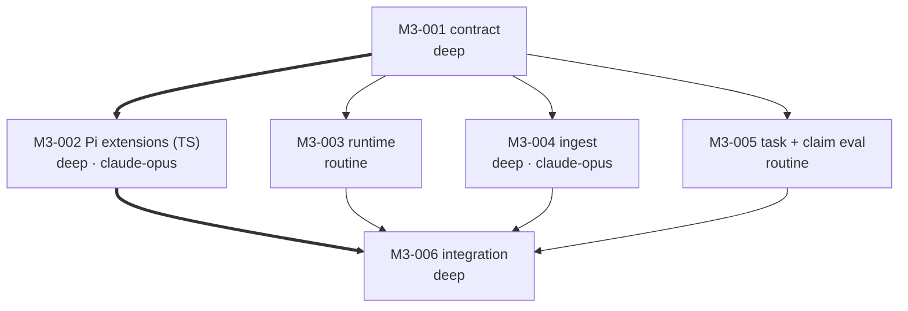

# Plan: M3 — Pi adapter and SoL-Pi variants

SOL_PI_DELTA §3/§5: Pi is the first agent adapter, SoL-Pi's four mechanisms
are individually toggleable recorded treatments, and the arms S0–S3 run on
the same frozen dev set, tools, information, and evaluator. No model
credentials are authorized (A11), so M3 builds the whole path against the
**real pinned Pi 0.85.1 process** (and real SoL-Pi at its pinned commit),
driven offline by a scripted provider registered through Pi's public
`registerProvider`/`streamSimple` API (A32). Live runs are built and fail
closed until an operator sets every live setting (A35). RLM (S1r) is a
declared arm that refuses to run; the extension is later work.

How a run flows: `task` stages a bundle for a pinned M2 case → `runtime`
launches `pi` with onoda's extensions (task tools first, SoL-Pi, scripted
provider, recorder last) → the extensions write an fsynced spool (the
write-ahead log; A37) → `ingest` turns the spool into store records →
`task.evaluate_claims` grades the agent's claim against the deterministic
parser in a separate evaluator store.

The M2 plan is kept at `docs/plans/M2-PLAN.md`.

Critical path: contract → extensions → integration. Runtime, ingest, and
task run beside the extensions against the contract.

Test commands for every lane: `uv run pytest`, `uv run ruff check .`,
`uv run ruff format --check .`; TypeScript: `cd pi && npx tsc -p .`.
Pi runtime for lanes that launch Pi: `scripts/pi-setup.sh` (already
installed in the main checkout; a lane worktree runs it once).

## M3-001 — Contract: pins, spool, script, bundle, claim, variants, policy

Everything the lanes share, landed in the main working copy first:
runtime pins and extension load order, env var names, spool layout and line
types (Python models + the TS writer), the scripted-provider script, the
staged task bundle, the agent's claim, the variant table S0–S3 and its
`sol-pi.json` mapping, the gateway policy, checkpoint context keys and
capabilities. Also the pinned Node package (`pi/package.json` +
lockfile), `scripts/pi-setup.sh`, the `requires_pi` test marker, and
assumptions A31–A37.

```yaml
id: M3-001
depth: deep
depends_on: []
footprint:
  modifies:  # landed in the main working copy before any lane dispatched
    - "PLAN.md::*"
    - "docs/ASSUMPTIONS.md::*"
    - ".gitignore::*"
    - "tests/conftest.py::*"
    - "src/onoda/adapters/pi/__init__.py::*"
    - "src/onoda/adapters/pi/contract.py::*"
    - "pi/package.json::*"
    - "pi/package-lock.json::*"
    - "pi/tsconfig.json::*"
    - "pi/extensions/lib/spool.ts::*"
    - "scripts/pi-setup.sh::*"
    - "docs/plans/M2-PLAN.md::*"
produces:
  - "src/onoda/adapters/pi/contract.py::VARIANTS"
  - "src/onoda/adapters/pi/contract.py::Variant"
  - "src/onoda/adapters/pi/contract.py::GatewayPolicy"
  - "src/onoda/adapters/pi/contract.py::TaskBundle"
  - "src/onoda/adapters/pi/contract.py::Claim"
  - "src/onoda/adapters/pi/contract.py::Script"
  - "src/onoda/adapters/pi/contract.py::SpoolLine"
  - "src/onoda/adapters/pi/contract.py::parse_spool_line"
  - "src/onoda/adapters/pi/contract.py::PI_CAPABILITIES"
  - "pi/extensions/lib/spool.ts::SpoolWriter"
  - "pi/extensions/lib/spool.ts::spool"
  - "pi/extensions/lib/spool.ts::replayKey"
  - "pi/extensions/lib/spool.ts::counters"
  - "tests/conftest.py::requires_pi"
gate: "cd pi && npx tsc -p . exits 0; uv run python -c 'from onoda.adapters.pi.contract import VARIANTS; VARIANTS[\"S3\"].sol_pi_config(reducer_provider=\"p\", reducer_model=\"m\")' exits 0; uv run pytest and ruff clean"
```

## M3-002 — onoda's Pi extensions (TypeScript)

Three extensions under `pi/extensions/`, all writing through `lib/spool.ts`:

- `onoda-task.ts` (loaded first): registers `case_input`, `orca_run`
  (sequential; returns the staged pinned output and spools `task.acquire`
  with `executed_here: false`), and `report_states` (validates a `Claim`,
  spools `task.claim`); appends `docs/*.md` and `ladder.md` from the bundle
  to the system prompt at `before_agent_start`; taps raw `tool_result`
  (`stage: raw`) before SoL-Pi's reducer can rewrite it.
- `onoda-scripted.ts`: registers provider `onoda-scripted` with models
  `scripted` and `scripted-reducer`, serving `Script.turns` /
  `reducer_turns` in order; spools `provider.request` (`source:
  scripted-provider`) with the raw context and its replay key; on an
  `expect_replay_key` mismatch spools `replay.mismatch` and ends the stream
  with an error; an exhausted script ends with an error, never a default reply.
- `onoda-recorder.ts` (loaded last): spools `spool.start` at
  `session_start` (fields from `ONODA_PI_RUN_INFO` + session id/dir),
  `provider.request` from `before_provider_request` for real providers,
  `provider.response` at assistant `message_end`, enforces `GatewayPolicy` at
  `tool_call` (spooling every call, allowed or blocked, before it runs),
  spools the visible `tool_result`, `compaction` from the session compaction
  events, aborts at `turn_start` past `max_requests`, and writes `spool.end`
  at `agent_settled` (or on shutdown if missing).

The gate launches the real pinned `pi` directly (no Python runtime module)
with hand-written scripts and checks the spool lines.

```yaml
id: M3-002
depth: deep
executor: claude-opus
depends_on: ["M3-001"]
footprint:
  creates:
    - "pi/extensions/onoda-task.ts"
    - "pi/extensions/onoda-scripted.ts"
    - "pi/extensions/onoda-recorder.ts"
    - "tests/test_pi_extensions.py"
    - "tests/fixtures/pi/*"
produces:
  - "pi/extensions/onoda-task.ts"
  - "pi/extensions/onoda-scripted.ts"
  - "pi/extensions/onoda-recorder.ts"
gate: "cd pi && npx tsc -p . exits 0; uv run pytest tests/test_pi_extensions.py passes against real pinned Pi: every line validates with parse_spool_line, seq is gap-free, S0 run spools start/request/response/tool.call/tool.result(raw+visible)/task.acquire/task.claim/end; a disallowed tool and a then_run containing 'orca' are blocked before running; ObservationPack (S2a config) archives a >10 KiB orca_run output and later requests show the handle; exhausted script ends script-exhausted; a wrong expect_replay_key ends replay-mismatch"
assumptions:
  - "SoL-Pi's then_run lives on its replacement edit/write tools as input.then_run.command"
  - "Pi fires before_provider_request only for built-in providers; the scripted provider records its own request"
```

## M3-003 — Runtime: doctor, launch, live gate

`src/onoda/adapters/pi/runtime.py`: `doctor()` checks node ≥ 22.19, the
installed Pi version and SoL-Pi commit against the contract pins (reads
`node_modules/**/package.json` and `package-lock.json`, never runs npm);
`build_launch(...)` produces argv/env for one run: isolated
`PI_CODING_AGENT_DIR` holding the variant's `sol-pi.json`,
`PI_OFFLINE=1`, `PI_TELEMETRY=0`, `--no-extensions` then `-e` in contract
load order (SoL-Pi only when the variant has mechanisms), `--tools` from
the variant, `--session-dir`, `--no-context-files --no-skills
--no-prompt-templates --mode json -p <instruction>`, and the policy/run-info
files including path aliases; `launch(...)` runs it with a timeout and
stdin closed and returns stdout/stderr/exit plus the spool and session dirs.
Scripted mode needs a `Script`; live mode refuses (`CapabilityError`) unless
provider, model, credential env var name (present in the environment),
`max_requests`, and `max_cost_usd` are all given. Ladder variants refuse
without a ladder; `rlm` variants always refuse in M3.

```yaml
id: M3-003
depth: routine
depends_on: ["M3-001"]
footprint:
  creates:
    - "src/onoda/adapters/pi/runtime.py"
    - "tests/test_pi_runtime.py"
produces:
  - "src/onoda/adapters/pi/runtime.py::doctor"
  - "src/onoda/adapters/pi/runtime.py::LiveSettings"
  - "src/onoda/adapters/pi/runtime.py::build_launch"
  - "src/onoda/adapters/pi/runtime.py::launch"
  - "src/onoda/adapters/pi/runtime.py::LaunchResult"
gate: "uv run pytest tests/test_pi_runtime.py passes: argv load order (task, sol-pi, scripted, recorder), sol-pi.json per variant, S0 omits SoL-Pi, live refused for each missing setting, ladder/rlm refusals, doctor flags a version or commit mismatch in a fake runtime dir, env has no inherited provider keys in scripted mode"
```

## M3-004 — Ingest: spool to portable run record

`src/onoda/adapters/pi/ingest.py`: `ingest_spool(store, spool_dir, *,
run_id, task_id, config)` validates every line, imports objects into the
store (same sha256 → same digest), and writes, in commit order: provider
request/response pairs as `decision` receipts (inputs `context`, outputs
`message`, usage from tokens + decimal cost, `simulated` for scripted runs),
tool calls as receipts (`read`/`execution`; blocked calls as `pi.tool-blocked`
events with no receipt), `orca_run` as an acquisition receipt citing the
pinned output (`executed_here: false`), Action Fusion calls decomposed with
`context.decompose_fused_call` (write_input + validate_input), ObservationPack
archives imported from `<session_dir>/sol-pi/<session>/observation-pack/`
as `context.observation-archived` events with an `obs_id → digest` map,
`obs_recall` calls as `context.page`, reducer rewrites (raw ≠ visible) as
`context.reduced`, compactions via `context.record_compaction`, the claim as
a `pi-claim` artifact, and checkpoints `initialized`, `job-collected` after
each acquisition, and `finalized` (or none for a spool without `spool.end`,
which ingests as an incomplete run) with contract context keys and
`PI_CAPABILITIES`. Re-ingesting the same spool is a no-op; a different
spool under the same run id is refused.

Tested with hand-written spool fixtures (valid contract lines, synthetic
labels) — no Pi process needed.

```yaml
id: M3-004
depth: deep
executor: claude-opus
depends_on: ["M3-001"]
footprint:
  creates:
    - "src/onoda/adapters/pi/ingest.py"
    - "tests/test_pi_ingest.py"
    - "tests/fixtures/pi_spool/*"
produces:
  - "src/onoda/adapters/pi/ingest.py::ingest_spool"
  - "src/onoda/adapters/pi/ingest.py::IngestResult"
  - "src/onoda/adapters/pi/ingest.py::run_claim"
  - "src/onoda/adapters/pi/ingest.py::recorded_script"
gate: "uv run pytest tests/test_pi_ingest.py passes: records validate, every event's refs committed before it, replay_run verifies the ingested run, activation_counts reports each mechanism, fused call decomposed, fused submit refused, OP handles map to store digests, incomplete spool has no finalized checkpoint, re-ingest idempotent, conflicting re-ingest refused, recorded_script rebuilds a Script with expect_replay_key per turn"
```

## M3-005 — Task bundle and claim evaluation

`src/onoda/adapters/pi/task.py`: `stage_bundle(case, dest, *, instruction,
docs, ladder)` writes a `TaskBundle` for a pinned M2 case (input + pinned
output, sha256-checked; no reference data). `evaluate_claims(agent_store,
run_id, evaluator_store, case)` grades the run's claim against the
deterministic parser's reading of the pinned output, in the evaluator store
only: each claimed state is matched by `(multiplicity, root)` exactly, never
by nearest energy; equal decimal values and units → `supported`, different →
`contradicted`, no such parsed state → `unsupported`; parsed states the case
requests that the claim omits → `missing`; unknown multiplicity on either
side → `unresolved`. Metrics are decimal strings: counts per class and
`false_success_claims = contradicted + unsupported`. No claim → every
requested state `missing`.

```yaml
id: M3-005
depth: routine
depends_on: ["M3-001"]
footprint:
  creates:
    - "src/onoda/adapters/pi/task.py"
    - "tests/test_pi_task.py"
produces:
  - "src/onoda/adapters/pi/task.py::stage_bundle"
  - "src/onoda/adapters/pi/task.py::evaluate_claims"
  - "src/onoda/adapters/pi/task.py::CLAIM_EVALUATOR"
gate: "uv run pytest tests/test_pi_task.py passes over every vendored case: staged bundle hashes match the manifest and contain no reference; supported/contradicted/unsupported/missing/unresolved each exercised; evaluation written only to the evaluator store"
assumptions:
  - "claims are graded against the M2 parser output of the same pinned bytes the agent saw; the reference-case comparison stays M2's evaluator"
```

## M3-006 — Integration: CLI, replay, end-to-end, docs

`onoda pi doctor|variants|run|replay|evaluate`: `run` stages the bundle,
launches, ingests, and prints the run summary (scripted by default;
`--live` needs every live flag); `replay` rebuilds the script from a
recorded run (`recorded_script`) and re-runs it, raising `ReplayMismatch` if
any request's replay key differs. End-to-end tests on the real pinned Pi
over a vendored case: S0 and S3 (synthetic ladder, scripted reducer) run,
ingest, verify with `replay_run`, evaluate, and replay cleanly; a changed
ladder makes replay fail closed. Update `docs/ADAPTER_SEAM.md` (what is now
verified against 0.85.1), README, `scripts/demo.sh`, and `CLAUDE.md`
toolchain.

```yaml
id: M3-006
depth: deep
depends_on: ["M3-002", "M3-003", "M3-004", "M3-005"]
footprint:
  modifies:
    - "src/onoda/cli.py::*"
    - "docs/ADAPTER_SEAM.md::*"
    - "README.md::*"
    - "scripts/demo.sh::*"
    - "CLAUDE.md::*"
  creates:
    - "src/onoda/adapters/pi/run.py"
    - "tests/test_pi_end_to_end.py"
gate: "uv run pytest (full suite) and ruff clean; tests/test_pi_end_to_end.py passes against real pinned Pi; scripts/demo.sh exits 0"
```

## Graph



## Deviations

- **Rename (after M3-001):** the package and CLI were renamed `labrun` →
  `onoda` on main before M3 landed; this plan's paths and names were rewritten
  to match (`src/onoda/...`, `onoda-*.ts`, `ONODA_PI_*`).
- **M3-002:** `before_provider_request` does fire for a custom provider that
  calls `options.onPayload` (Pi requires it), contrary to this plan's
  assumption; the recorder skips it for the scripted provider so each request
  is spooled once. SoL-Pi's reducer only rewrites build/test-log output, so S2b
  is inert on the task tools. Reducer calls go through `complete()` with no
  hooks: the scripted provider spools them itself; a live reducer's calls are
  not spooled yet.
- **M3-004:** `ingest_spool` takes the `TaskManifest` (not a task id). The
  integration changed its checkpoint `visible` map to exclude the case
  manifest, which the agent never sees.
- **M3-006:** `build_launch` resolves `bundle_dir`/`work_dir` to absolute
  paths (Pi runs with the workspace as cwd; the demo passed relative paths).
