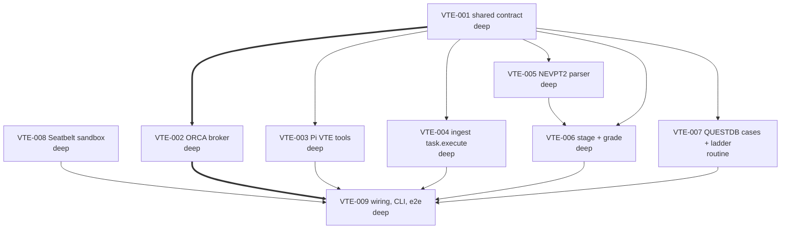

# Plan: QUESTDB agent slice — an agent runs its own CASSCF/SC-NEVPT2 jobs

Scope and phase-0 evidence: `/mnt/project-files/scientific-harness/questdb-slice/SCOPE.md`
(project files). Built on branch `questdb-data` (on top of `orca-exec`, PR #15,
orca-parser@2), which carries the phase-0 data and real ORCA 6.1.1 NEVPT2
fixtures from the Mac.

What this slice delivers: everything needed to run Lee & Rondinelli's
Baseline-vs-Decision comparison in miniature on Vu's Mac. An agent (Pi, S0 =
no ladder, S1 = ladder) gets a molecule's QUESTDB geometry and its target
states (counts per spin and irrep, no energies), writes ORCA inputs, submits
them through a new `orca_submit` tool that really executes ORCA on the host,
and reports vertical transition energies with their identity. A grader checks
every claimed value against the parser's reading of the job the agent cites,
and matches states to QUESTDB's SC-NEVPT2 references by identity, never by
energy order. Out of scope here: running the experiment itself, the ablation
and optimizer integration (GEPA over the ladder), which come after this lands.

Decisions taken (recorded as assumptions A57–A62 by VTE-001):

- **Execution broker.** ORCA cannot run inside the Pi sandbox, so a host-side
  Python broker owns `OrcaLocalScheduler`; the Pi extension talks to it over a
  Unix socket in the Pi work directory (visible to the Pi process, not to the
  agent's `bash`). The broker's journal is the authoritative execution record;
  ingest cross-checks every spooled `task.execute` against it.
- **Cache.** Jobs are keyed by sha256 of (input bytes, attached files, ORCA
  binary). A hit returns the earlier output and is recorded as acquired
  (`executed_here: false`, `cache_hit: true`), never as a new execution.
  Scripted replay uses the same path in replay-only mode and never runs ORCA.
- **Attempt cap.** At most `max_executions` submissions per run (cache hits
  included), default 24 (8 per target spec × typical 3 specs); recorded.
- **Identity grading.** A claimed state names spin, irrep, character label
  and the job id it came from. Its energy must be printed for a state of that
  spin and irrep in that job's NEVPT2 output (else `contradicted`; a job not
  executed or cached in this run is `unsupported`). It is *identified* when
  (spin, irrep) picks exactly one reference row, or the normalized character
  label picks one among several. Coverage, MAE and false-success counts are
  reported; nothing is matched by energy order.
- **macOS sandbox.** A Seatbelt (`sandbox-exec`) backend with the same two
  layers and rules as bwrap; Linux keeps bwrap.
- **Ladder.** `experiments/questdb/ladder-from-paper.md`, rules A–H
  reconstructed from Sec. II D–E of arXiv 2609.13357, labelled a
  reconstruction (A33 instance). Baseline gets no ladder and no ORCA manual
  (the manual is not redistributable).

Critical path: VTE-001 contract → VTE-002 broker → VTE-003 Pi tools → VTE-009
wiring and end-to-end test.

## VTE-001 — Shared contract: VTE task, claim, spool line, broker protocol, case schema

The types every other task builds on. Python models only (the TypeScript
mirror is VTE-003's). Pins the wire shapes so lanes stay disjoint.

- `src/onoda/adapters/pi/vte_contract.py` (new): `VteTaskBundle`
  (schema `onoda.pi-vte-task/1`: case_id, instruction, structure name+sha256,
  targets name+sha256, point_group, docs, ladder_sha256, max_executions),
  `VteTarget` (spin, irrep, count), `ClaimedVte` (spin, irrep, character,
  energy `ClaimedQuantity` in eV, job_id), `VteClaim` (schema
  `onoda.pi-vte-claim/1`), broker protocol `BrokerSubmit` (input text, attach:
  list of {job_id, name}), `BrokerReply` (job_id, status, cache_hit,
  executed_here, output text, output sha256, files list, reason),
  `BROKER_PROTOCOL`, tool names `TOOL_STRUCTURE`, `TOOL_ORCA_SUBMIT`,
  `TOOL_REPORT_VTE`, `VTE_TASK_TOOLS`, `ENV_BROKER`, `DEFAULT_MAX_EXECUTIONS`.
- `src/onoda/adapters/pi/contract.py`: `TaskExecute` spool line (tool_call_id,
  job_id, input sha, output sha, cache_hit, executed_here) added to
  `SpoolLine`; `Variant.tools()` takes a task kind (`"case"` default,
  `"vte"`); `GatewayPolicy.max_executions` (default 0).
- `src/onoda/science/vte.py` (new): `VteCaseManifest` (case_id, molecule,
  point_group, structure PinnedFile, targets, provenance, review, split),
  `VteReference` / `VteReferenceRow` (spin, irrep, character, sc_nevpt2_ev
  decimal text, active space, state average), `load_vte_case`,
  `load_vte_references` (evaluator-side only), `vte_case_manifests(root)`,
  `normalize_character()` (QUESTDB's Symbol-font glyphs → ascii, e.g.
  `` → `pi`).
- `docs/ASSUMPTIONS.md`: rows A57–A62 for the decisions above.

```yaml
id: VTE-001
task_type: feature
depth: deep
depends_on: []
footprint:
  modifies:
    - "src/onoda/adapters/pi/contract.py::Variant"
    - "src/onoda/adapters/pi/contract.py::GatewayPolicy"
    - "src/onoda/adapters/pi/contract.py::SpoolLine"
    - "src/onoda/adapters/pi/contract.py::TaskAcquire"
    - "docs/ASSUMPTIONS.md::*"
  creates:
    - "src/onoda/adapters/pi/vte_contract.py"
    - "src/onoda/science/vte.py"
    - "tests/test_vte_contract.py"
produces:
  - "src/onoda/adapters/pi/vte_contract.py::VteTaskBundle"
  - "src/onoda/adapters/pi/vte_contract.py::VteTarget"
  - "src/onoda/adapters/pi/vte_contract.py::ClaimedVte"
  - "src/onoda/adapters/pi/vte_contract.py::VteClaim"
  - "src/onoda/adapters/pi/vte_contract.py::BrokerSubmit"
  - "src/onoda/adapters/pi/vte_contract.py::BrokerReply"
  - "src/onoda/adapters/pi/vte_contract.py::VTE_TASK_TOOLS"
  - "src/onoda/adapters/pi/contract.py::TaskExecute"
  - "src/onoda/adapters/pi/contract.py::GatewayPolicy"
  - "src/onoda/science/vte.py::VteCaseManifest"
  - "src/onoda/science/vte.py::VteReferenceRow"
  - "src/onoda/science/vte.py::load_vte_case"
  - "src/onoda/science/vte.py::load_vte_references"
  - "src/onoda/science/vte.py::normalize_character"
gate: "uv run pytest tests/test_vte_contract.py -q passes; uv run ruff check . and ruff format --check . pass"
assumptions:
  - "existing tests that build GatewayPolicy or call Variant.tools() keep passing unchanged (new args default to today's behaviour)"
```

## VTE-002 — Host-side ORCA broker with cache and attempt cap

`src/onoda/science/orca_broker.py`: a Unix-socket JSON-lines server (one
thread) around `OrcaLocalScheduler`. Handles `BrokerSubmit`: resolves `attach`
entries to files of earlier jobs *of this broker* (e.g. `.gbw`), computes the
cache key, serves a cache hit from the shared cache directory or submits a
new job, enforces `max_executions`, and appends every request and reply to
`broker.jsonl` (host-side journal: key, job_id, status, executed_here,
cache_hit, input/output sha256, duration, binary sha256). A `replay` mode
serves only recorded outputs (from a dict of key → bytes) and refuses
anything else. `orca_local.OrcaLocalScheduler.submit` learns to place extra
input files next to `job.inp` and to expose a job's produced files.

```yaml
id: VTE-002
task_type: feature
depth: deep
depends_on: ["VTE-001"]
footprint:
  modifies:
    - "src/onoda/science/orca_local.py::OrcaLocalScheduler"
  creates:
    - "src/onoda/science/orca_broker.py"
    - "tests/test_orca_broker.py"
produces:
  - "src/onoda/science/orca_broker.py::OrcaBroker"
  - "src/onoda/science/orca_broker.py::BrokerJournalEntry"
  - "src/onoda/science/orca_broker.py::read_journal"
gate: "uv run pytest tests/test_orca_broker.py tests/test_orca_local.py -q passes, covering: real execution via a labelled stand-in executable, cache hit recorded as executed_here false, attach of an earlier job's file, max_executions refusal, replay mode never executing, journal written before reply"
```

## VTE-003 — Pi tools for the VTE task (TypeScript)

In `pi/extensions/onoda-task.ts`, when `task.json` is `onoda.pi-vte-task/1`:
register `structure` (returns the xyz and targets), `orca_submit` (sends a
`BrokerSubmit` to `ENV_BROKER`'s socket, spools `task.execute` with the
output object written and fsynced first, returns the output text; long
outputs pass through unchanged so ObservationPack handles them) and
`report_vtes` (validates and spools a `VteClaim` as `task.claim`). The
case-kind tools stay exactly as they are. `onoda-recorder.ts` enforces
`max_executions` on `orca_submit` like `max_acquisitions` on `orca_run`.
`lib/spool.ts` mirrors the new constants.

```yaml
id: VTE-003
task_type: feature
depth: deep
depends_on: ["VTE-001"]
footprint:
  modifies:
    - "pi/extensions/onoda-task.ts::*"
    - "pi/extensions/onoda-recorder.ts::*"
    - "pi/extensions/lib/spool.ts::*"
  creates:
    - "tests/test_pi_vte_tools.py"
produces:
  - "pi/extensions/onoda-task.ts::onodaTask"
gate: "cd pi && npx tsc -p . passes; uv run pytest tests/test_pi_vte_tools.py tests/test_pi_extensions.py -q passes (requires_pi: a scripted Pi run against a fake broker socket submits, spools task.execute, reports a VteClaim, and is blocked past max_executions)"
assumptions:
  - "the test's fake broker is a small Python socket server inside the test file, so this lane does not wait on VTE-002"
```

## VTE-004 — Ingest `task.execute` lines with the broker cross-check

`ingest.py`: a `task.execute` line becomes an `execution` receipt
(`executed_here: true`, labels `orca-local`) or, for a cache hit, an
acquisition `read` receipt (`executed_here: false`, `cache_hit: true`); both
cite the input and output objects and are followed by a `job-collected`
checkpoint. `ingest_spool` takes an optional broker journal and refuses the
spool if any `task.execute` disagrees with it (job id, output sha256,
executed_here) or cites a job the broker never ran. VTE claims are stored as
`pi-vte-claim` artifacts.

```yaml
id: VTE-004
task_type: feature
depth: deep
depends_on: ["VTE-001"]
footprint:
  modifies:
    - "src/onoda/adapters/pi/ingest.py::*"
  creates:
    - "tests/test_pi_ingest_vte.py"
produces:
  - "src/onoda/adapters/pi/ingest.py::ingest_spool"
  - "src/onoda/adapters/pi/ingest.py::run_vte_claim"
gate: "uv run pytest tests/test_pi_ingest_vte.py tests/test_pi_ingest.py -q passes, including refusal on a journal mismatch and a cited-but-never-run job"
```

## VTE-005 — Parse SA-CASSCF / SC-NEVPT2 excitation energies (ORCA 6.1.1)

Extend `orca_parser` (stays `orca-parser@2`'s successor: bump to `@3` because
the same bytes now yield more fields) to read the CASSCF state listing and
the NEVPT2 transition-energy summary into `OrcaObservation.mr_states`: per
state its method (`CASSCF`/`SC-NEVPT2`), multiplicity, irrep when symmetry is
on (None otherwise), root, and the excitation energy in eV and au as printed,
with line evidence; plus `casscf_converged`. Non-converged CASSCF and
"terminated normally" with a failed CASSCF are explicit problems. Fixtures are
real ORCA 6.1.1 outputs from the Mac (`tests/fixtures/orca611-nevpt2/`,
branch `questdb-data`).

```yaml
id: VTE-005
task_type: feature
depth: deep
depends_on: ["VTE-001"]
footprint:
  modifies:
    - "src/onoda/science/orca_parser.py::*"
    - "src/onoda/science/contract.py::OrcaObservation"
    - "src/onoda/science/contract.py::ExcitedState"
  creates:
    - "tests/test_orca_parser_nevpt2.py"
produces:
  - "src/onoda/science/orca_parser.py::parse_orca_output"
  - "src/onoda/science/contract.py::OrcaObservation"
gate: "uv run pytest tests/test_orca_parser_nevpt2.py tests/test_orca_parser.py tests/test_smoke_cases.py -q passes on the real ORCA 6.1.1 fixtures (formaldehyde, ethylene converged and non-converged, ketene, acetone)"
assumptions:
  - "fixtures are already on the base branch (tests/fixtures/orca611-nevpt2/, 14 real ORCA 6.1.1 jobs from the Mac, with a README of symmetry/command per job)"
  - "ORCA prints irreps in the NEVPT2 summary when symmetry is on; if it only prints them in the CASSCF block, the parser joins by (mult, root)"
```

## VTE-006 — Stage VTE bundles and grade VTE claims

`src/onoda/adapters/pi/vte.py`: `stage_vte_bundle(case, dest, ...)` writes
`task.json`, `structure/<name>.xyz`, `targets.json`, docs, ladder (nothing
from the reference file), and `evaluate_vte_claims(evaluator_store, run_id,
case, references, claim, jobs)` grades per the identity rule above, where
`jobs` maps job id → (output bytes, executed_here, cache_hit) from the run
record. Writes one `Evaluation` (`vte-claims` v1) to the evaluator store only,
with per-reference verdicts (`identified`, `unidentified`, `missing`), per
claim verdicts, `coverage`, `mae_ev` over identified states (decimal text),
`false_success_claims`, and per-state error.

```yaml
id: VTE-006
task_type: feature
depth: deep
depends_on: ["VTE-001", "VTE-005"]
footprint:
  creates:
    - "src/onoda/adapters/pi/vte.py"
    - "tests/test_pi_vte_grading.py"
produces:
  - "src/onoda/adapters/pi/vte.py::stage_vte_bundle"
  - "src/onoda/adapters/pi/vte.py::evaluate_vte_claims"
gate: "uv run pytest tests/test_pi_vte_grading.py -q passes: supported/contradicted/unsupported claims, unique and character-disambiguated identification, an energy-order-only match left unidentified, references never written into the staged bundle"
```

## VTE-007 — Eight QUESTDB cases and the reconstructed ladder

`scripts/questdb_cases.py` builds `cases-dev/questdb/<molecule>/` from a
QUESTDB checkout (pfloos/QUESTDB @ 460482b): `<id>.vte.yaml` (`VteCaseManifest`),
the CC3/aug-cc-pVTZ `.xyz`, and `references.json` (evaluator-only rows from
`data/cas/json/*_mrpt.json`, SC-NEVPT2 values, with active space and state
average). Molecules: acetaldehyde, formamide, ketene, diazomethane, acetone,
thioacetone, methylenecyclopropene, cyclopropenone; fluorescence rows that
need an excited-state geometry are dropped. A credit README (CC BY-SA 4.0,
source commit). `experiments/questdb/ladder-from-paper.md` reconstructs rules
A–H and the four validation criteria from the paper, labelled as such.

```yaml
id: VTE-007
task_type: feature
depth: routine
depends_on: ["VTE-001"]
footprint:
  creates:
    - "scripts/questdb_cases.py"
    - "cases-dev/questdb/**"
    - "experiments/questdb/ladder-from-paper.md"
    - "tests/test_questdb_cases.py"
produces:
  - "cases-dev/questdb/**"
  - "experiments/questdb/ladder-from-paper.md"
gate: "uv run pytest tests/test_questdb_cases.py -q passes: all 8 cases load with load_vte_case, sha256 pins verify, reference rows match the QUESTDB JSON, total transitions 53, and no references.json content appears in any .vte.yaml"
```

## VTE-008 — macOS Seatbelt sandbox backend

Refactor `sandbox.py` so `Sandbox` is the bwrap backend and add
`SeatbeltSandbox` with the same interface (`outer_argv`, `stage`,
`pi_settings`): a generated `.sb` profile per layer. Outer: file reads of
system paths, runtime, node, python, bundle; read-write only the Pi work dir
and a private tmp; network allowed. Inner (bash, kernel): no network, cleared
environment, read-write workspace only, bundle read-only, no access to the
spool, session, broker socket or RLM dirs. `runtime.detect_sandbox` picks the
backend by platform and refuses anything else, as today. `SANDBOX_KIND`
becomes per-backend (`bwrap` / `seatbelt`).

```yaml
id: VTE-008
task_type: feature
depth: deep
depends_on: []
footprint:
  modifies:
    - "src/onoda/adapters/pi/sandbox.py::*"
    - "src/onoda/adapters/pi/runtime.py::detect_sandbox"
  creates:
    - "tests/test_pi_sandbox_seatbelt.py"
produces:
  - "src/onoda/adapters/pi/sandbox.py::SeatbeltSandbox"
  - "src/onoda/adapters/pi/runtime.py::detect_sandbox"
gate: "uv run pytest tests/test_pi_sandbox.py tests/test_pi_sandbox_seatbelt.py -q passes on Linux (profile generation and backend selection; darwin-only tests skip); on the Mac the darwin tests pass (inner layer has no network and cannot read outside the workspace)"
assumptions:
  - "the darwin half of the gate is run on Vu's Mac via Remote Control after the lane lands"
```

## VTE-009 — Wire it together: run, evaluate, report, end-to-end

`run.py::run_vte_case` stages the bundle, starts the broker on a socket in the
Pi work dir, launches Pi with the VTE tools (`build_launch(task_kind="vte",
broker_socket=...)`), stops the broker, ingests with the journal, and commits
the task (structure, targets, docs, ladder; never references).
`replay_run_pi` replays VTE runs with the broker in replay mode. CLI:
`onoda pi run-vte <case> ...` (same live settings as `pi run`, plus
`--orca-binary`, `--orca-work-root`, `--max-wall-seconds`,
`--max-executions`, `--orca-cache`), `onoda pi evaluate-vte <run>` and
`onoda vte report <runs...>` (coverage, MAE, false success per arm,
common-target MAE between two arms). `experiments/questdb/run.sh` runs S0 and
S1 over the 8 cases with repeats. README and CLAUDE.md sections.

```yaml
id: VTE-009
task_type: feature
depth: deep
depends_on: ["VTE-002", "VTE-003", "VTE-004", "VTE-006", "VTE-007", "VTE-008"]
footprint:
  modifies:
    - "src/onoda/adapters/pi/run.py::*"
    - "src/onoda/adapters/pi/runtime.py::build_launch"
    - "src/onoda/cli.py::*"
    - "README.md::*"
    - "CLAUDE.md::*"
  creates:
    - "experiments/questdb/run.sh"
    - "tests/test_pi_vte_end_to_end.py"
gate: "uv run pytest -q passes (full suite, Linux, Pi installed), including a scripted end-to-end VTE run with a labelled stand-in ORCA that records an execution, a cache hit and a claim, grades it, replays it offline with zero executions, and refuses a run whose bundle would contain references; ruff check/format and pi tsc pass"
```

## Graph



## Deviations

- VTE-001: the decisions became six assumption rows (A57–A62), not seven; the
  gate's `tests/test_pi_contract.py` does not exist and was dropped. VTE
  manifests are named `<id>.vte.yaml` (`VTE_MANIFEST_SUFFIX`) so `case list`
  and the optimizer splits, which glob `*.case.yaml`, never pick them up.
- VTE-008 (escalation): `build_launch` (runtime.py) and `run_case` (run.py)
  record `SANDBOX_KIND` ("bwrap") even under Seatbelt. VTE-009 owns both call
  sites already; it records `sandbox.kind` instead. Nested `sandbox-exec`
  (inner wrapper under the outer profile) may be refused by macOS; the darwin
  test `test_darwin_outer_layer_runs_the_inner_wrapper_and_hides_the_host`
  decides it on the Mac before the experiment. If refused, a host-side
  launcher is a follow-up slice, not this PR. Kernel socket paths must stay
  under macOS's 104-byte limit; VTE-009's run.sh uses a short work root.
- VTE-003 (notes for VTE-009): the gateway's `max_executions` and the
  bundle's must be the same value; ingest treats a broker-journal job with no
  `task.execute` line as a mismatch. RLM children copy the parent policy
  without subtracting executions; VTE runs do not enable RLM in this slice,
  and the broker's own per-run cap still bounds them.
- VTE-002 (notes for VTE-009): an attached file is placed next to the new
  input as `<job_id><suffix>` (`j0001` + `job.gbw` -> `j0001.gbw`), so the
  `orca_submit` tool doc must tell the agent to read it with
  `%moinp "j0001.gbw"`. Only completed jobs are cached; the broker counts
  only submissions that got a job, the recorder counts every call. Replay
  needs the recorded produced-file digests (`BrokerReplay.from_journal`). The
  cache key covers the ORCA driver binary's sha256 only, not its sibling
  programs or MPI (review item).
