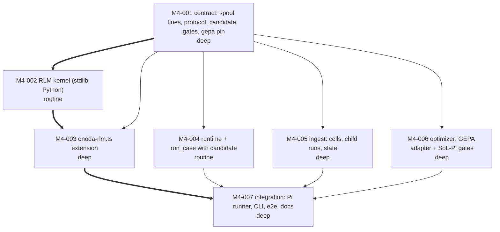

# Plan: M4 — onoda's RLM extension and GEPA as the harness optimizer

Vu decided on 2026-09-27 (thread "RLM and SoL-Pi reuse") to build our own RLM
as a stock-Pi extension, and to use GEPA (MIT, `gepa==0.1.4`, core has no
dependencies) as the one optimizer. GEPA serves two jobs: it makes the RLM
self-improving, and it becomes the reconstructed SoL-Pi auto-research loop.
Third-party Pi RLM packages are ruled out. DSPy RLM is used as a design
reference only. Background: `docs/handoff/SOL_PI_DELTA.md` §0/§3/§5 and
`/mnt/project-files/scientific-harness/reuse-evaluation.md`.

What M4 builds:

- **RLM (arm S1r).** A persistent `ipython` tool, backed by a stdlib-only
  Python kernel. Inside the kernel, `rlm(prompt, context=None)` spawns a
  child Pi process and returns the child's answer as a string. The child
  loads the same onoda extensions (task tools, scripted provider, recorder).
  It spools into its own directory under the parent's spool, and it draws
  from the parent's request budget.
- **Kernel state (SOL_PI_DELTA §3).** Kernel state is never a checkpoint
  dependency. Anything a later step relies on goes through
  `commit_state(name, value)`. Committed values must be JSON, never pickle,
  and they are spooled before the kernel acknowledges the commit.
- **Self-improvement.** Everything that shapes RLM behavior is a named text
  component of a `HarnessCandidate`: the system prompt, the tool doc, the
  child prompt, a preloaded helper library, the limits, the advisory ladder,
  and the SoL-Pi mechanism set. Improvement happens between runs, never
  inside one. GEPA proposes candidates from recorded runs, and SoL-Pi's two
  gates decide promotion as a GEPA `AcceptanceCriterion`. The gates are
  every capability metric within a predeclared tolerance, zero increase in
  false-success claims, and at least one efficiency metric improved.
- **Out of scope for the optimizer.** The evaluator, parsers, gateway,
  budget authority, and the untouched final split are never reachable from
  it. Prime's in-run `/refine` style of self-rewriting is excluded.

Everything stays offline. Scripted providers drive the parent and child Pi
processes, and a scripted reflection callable stands in for GEPA's
reflection model.

Critical path: contract → kernel → extension → integration. Runtime, ingest,
and the optimizer run alongside the kernel and extension against the
contract.

Test commands for every lane: `uv run pytest`, `uv run ruff check .`,
`uv run ruff format --check .`; TypeScript: `cd pi && npx tsc -p .`.
Pi runtime for lanes that launch Pi: `scripts/pi-setup.sh`.

The M3 and M3b plans are kept at `docs/plans/M3-PLAN.md` and `docs/plans/M3b-PLAN.md`.

## M4-001 — Contract: RLM spool lines, kernel protocol, candidate, gates, pin

This task lands everything the lanes share, in the main working copy first.

`contract.py` additions:

- `RLM_EXTENSION`, the tool name `ipython`, and the env vars (`ONODA_PI_RLM_DEPTH`, `ONODA_PI_RLM_COMPONENTS`, `ONODA_PI_RLM_CHILD_SCRIPTS`).
- `RlmLimits`: max depth, max children, and max output chars.
- Spool line types: `rlm.cell` (code and output object digests), `rlm.child.start` and `rlm.child.end` (child index, depth, spool subdir, exit status, usage), and `rlm.state` (a committed JSON value's digest).
- `CTX_RLM_STATE`.
- `Script.children`, so a scripted parent carries its children's scripts.
- `HarnessCandidate`: a fixed allowlist of component names, each with a validator. `sol_pi.config` may only toggle the four mechanisms.
- `SEED_CANDIDATE`, with DSPy RLM's action prompt adapted as the seed system prompt and its provenance recorded.
- `Variant("S1r")` loses its refusal flag.

Other files:

- `pi/extensions/lib/rlm-protocol.ts` and the matching Python constants: the kernel's JSONL request/reply shapes.
- `spool.ts` writers for the new lines.
- `src/onoda/optimize/contract.py`:
  - `OutcomeVector`, with capability and efficiency metrics as decimal strings.
  - `GateSpec`: per-metric tolerances, plus `false_success_tolerance` fixed at 0.
  - `SplitAssignment`: acceptance slice and untouched final slice, saved as an immutable artifact with its seed.
  - `CandidateRecord`.
- Pin `gepa==0.1.4` with no extras in `pyproject.toml`/`uv.lock`.
- Add S17 (GEPA wheel) and S18 (DSPy, reference only) to `provenance/sources.json`.
- Assumptions A43–A48 (renumbered from A39–A44 after M3b took those):
  - A43: kernel state is externalized as JSON only.
  - A44: children share the parent's request budget.
  - A45: the candidate component allowlist.
  - A46: GEPA's `gepa_state.bin` is operational scratch. It is never imported, exported, or authoritative.
  - A47: the gate tolerances are unresolved. The loop refuses to run until an operator sets every tolerance.
  - A48: the split over the six pending-review cases is labelled exploratory until the cases are reviewed.

```yaml
id: M4-001
depth: deep
depends_on: []
footprint:
  modifies:
    - "src/onoda/adapters/pi/contract.py::*"
    - "pi/extensions/lib/spool.ts::*"
    - "docs/ASSUMPTIONS.md::*"
    - "provenance/sources.json::*"
    - "pyproject.toml::*"
    - "uv.lock::*"
  creates:
    - "pi/extensions/lib/rlm-protocol.ts"
    - "src/onoda/optimize/__init__.py"
    - "src/onoda/optimize/contract.py"
    - "tests/test_rlm_contract.py"
produces:
  - "src/onoda/adapters/pi/contract.py::RLM_EXTENSION"
  - "src/onoda/adapters/pi/contract.py::RlmLimits"
  - "src/onoda/adapters/pi/contract.py::RlmCell"
  - "src/onoda/adapters/pi/contract.py::RlmChildStart"
  - "src/onoda/adapters/pi/contract.py::RlmChildEnd"
  - "src/onoda/adapters/pi/contract.py::RlmState"
  - "src/onoda/adapters/pi/contract.py::CTX_RLM_STATE"
  - "src/onoda/adapters/pi/contract.py::HarnessCandidate"
  - "src/onoda/adapters/pi/contract.py::SEED_CANDIDATE"
  - "src/onoda/adapters/pi/contract.py::KERNEL_PROTOCOL"
  - "pi/extensions/lib/rlm-protocol.ts::KernelRequest"
  - "pi/extensions/lib/rlm-protocol.ts::KernelReply"
  - "pi/extensions/lib/spool.ts::SpoolWriter"
  - "src/onoda/optimize/contract.py::OutcomeVector"
  - "src/onoda/optimize/contract.py::GateSpec"
  - "src/onoda/optimize/contract.py::SplitAssignment"
  - "src/onoda/optimize/contract.py::CandidateRecord"
gate: "cd pi && npx tsc -p . exits 0; uv run pytest tests/test_rlm_contract.py passes (every new spool line round-trips through parse_spool_line; HarnessCandidate rejects an undeclared component and a sol_pi.config that sets anything but the four mechanism booleans; GateSpec refuses construction with an unset tolerance or a nonzero false_success_tolerance; SEED_CANDIDATE validates); uv run python -c 'import gepa' exits 0; full uv run pytest and ruff clean"
assumptions:
  - "Script gains an optional children field without breaking M3 scripts (default empty)"
```

## M4-002 — RLM kernel (Python, stdlib only)

`pi/rlm/onoda_rlm_kernel.py` holds one persistent namespace per session and
speaks `KERNEL_PROTOCOL` over a unix socket.

- `exec` runs a cell and returns its stdout/stderr, capped at `max_output_chars` with an explicit truncation marker. An exception returns as an error reply, and the kernel keeps running.
- `rlm(prompt, context=None)` sends a child request to the host and blocks for the host's reply string. A refusal (depth or budget) raises in the cell with the host's reason.
- `commit_state(name, value)` accepts JSON-serializable values only and blocks until the host confirms the value is spooled.
- The helper-library component is exec'd into the namespace at start.

The kernel imports no network, pickle, or subprocess modules.

```yaml
id: M4-002
depth: routine
depends_on: ["M4-001"]
footprint:
  creates:
    - "pi/rlm/onoda_rlm_kernel.py"
    - "tests/test_rlm_kernel.py"
produces:
  - "pi/rlm/onoda_rlm_kernel.py"
gate: "uv run pytest tests/test_rlm_kernel.py passes against a fake host socket: namespace persists across cells; output over max_output_chars is truncated with the marker; a raising cell returns an error and the next cell still runs; rlm() round-trips a host reply and surfaces a host refusal as an exception; commit_state refuses a non-JSON value and blocks until acknowledged; helpers component is available in the namespace; an AST check finds no import of pickle, marshal, subprocess, urllib, http, or ssl, and every socket it opens is AF_UNIX"
```

## M4-003 — `onoda-rlm.ts` Pi extension

The extension registers the `ipython` tool. It starts the kernel and stops it
at session end.

- **Spooling.** Every cell is spooled as `rlm.cell`, and the raw tool result is spooled before Pi hands it to the model, following the M3 tap rule. Each `commit_state` is spooled as `rlm.state` before the kernel is acknowledged.
- **Children.** `rlm()` spawns a child `pi` with the parent's extension list, flags, provider, and model, and `ONODA_PI_RLM_DEPTH`+1. The child gets its own spool dir `<spool>/children/<nnnn>` and its own spool key. In scripted mode it gets `Script.children[n]`. Its request cap is the parent's remaining budget. The parent spools `rlm.child.start` and `rlm.child.end` around it.
- **Refusals.** A child beyond max depth, max children, or the remaining budget is refused with a recorded reason and never spawned.
- **Components.** The system-prompt and tool-doc components are read from `ONODA_PI_RLM_COMPONENTS` and applied at `before_agent_start`.
- **Load order.** This extension loads after SoL-Pi and before the scripted provider and recorder.

```yaml
id: M4-003
depth: deep
depends_on: ["M4-001", "M4-002"]
footprint:
  creates:
    - "pi/extensions/onoda-rlm.ts"
    - "tests/test_pi_rlm_extension.py"
    - "tests/pi_fixtures/rlm/*"
produces:
  - "pi/extensions/onoda-rlm.ts"
gate: "cd pi && npx tsc -p . exits 0; uv run pytest tests/test_pi_rlm_extension.py passes against real pinned Pi (requires_pi) with hand-built argv: a scripted parent runs two ipython cells sharing a variable, calls rlm() once, and the child (scripted, own spool under children/0000) answers; parent and child spools validate line-by-line with gap-free seq; rlm.cell/rlm.child.start/rlm.child.end/rlm.state appear before the tool result that cites them; a second rlm() past max_children is refused and spooled; a child's request count is capped by the parent's remaining max_requests; commit_state of a non-JSON value is an error, not a spool line"
assumptions:
  - "the recorder needs no change because child spools are separate directories; if it must learn about children this task escalates rather than editing onoda-recorder.ts"
```

## M4-004 — Runtime and run: launch S1r with a candidate

- **`build_launch`.** Allows `rlm` variants and loads `onoda-rlm.ts` in contract order. It writes the candidate's components file and the child scripts dir, and adds `candidate_digest` and `rlm_limits` to `run_info`. It applies the candidate's `sol_pi.config` and ladder when those components are set.
- **`run_case`.** Takes an optional `HarnessCandidate` and threads it through. With no candidate given, it uses the M3 behavior exactly. Non-RLM argv and env stay byte-identical to M3 when no candidate is given.

```yaml
id: M4-004
depth: routine
depends_on: ["M4-001"]
footprint:
  modifies:
    - "src/onoda/adapters/pi/runtime.py::build_launch"
    - "src/onoda/adapters/pi/runtime.py::Launch"
    - "src/onoda/adapters/pi/run.py::run_case"
    - "tests/test_pi_runtime.py::*"
produces:
  - "src/onoda/adapters/pi/run.py::run_case"
  - "src/onoda/adapters/pi/runtime.py::build_launch"
gate: "uv run pytest tests/test_pi_runtime.py passes: S1r no longer refused; argv order task, sol-pi (when mechanisms), rlm, scripted, recorder; components file content equals the candidate's rlm components and run_info carries its digest; child scripts staged one file per Script.children entry; S0-S3 argv/env with no candidate equal the M3 golden values; a candidate sol_pi.config overrides the variant's mechanisms and is recorded"
```

## M4-005 — Ingest: RLM cells, child runs, committed state

`ingest_spool` learns the new line types.

- **Cells.** An `rlm.cell` becomes a tool receipt, with code and output as objects.
- **Children.** Each child spool is ingested as its own run (`<run_id>/rlm-<nnnn>`). It is linked to the parent by a `rlm.child` event that cites the child run's finalized checkpoint, or its absence for an incomplete child.
- **Committed state.** An `rlm.state` value becomes an artifact. Checkpoints carry `CTX_RLM_STATE` (name → digest), which lets a checkpoint rely on committed state and not on kernel memory.
- **Costs.** `budgets.cost_views` includes child-run usage in the parent's totals, fixing the same bug Prime had.
- **Replay.** `recorded_script` rebuilds `Script.children` recursively. A replay mismatch in any child fails the parent's replay closed.

```yaml
id: M4-005
depth: deep
depends_on: ["M4-001"]
footprint:
  modifies:
    - "src/onoda/adapters/pi/ingest.py::*"
    - "src/onoda/budgets.py::cost_views"
  creates:
    - "tests/test_pi_rlm_ingest.py"
    - "tests/pi_fixtures/rlm_spools/*"
produces:
  - "src/onoda/adapters/pi/ingest.py::ingest_spool"
  - "src/onoda/adapters/pi/ingest.py::recorded_script"
gate: "uv run pytest tests/test_pi_rlm_ingest.py tests/test_pi_ingest.py passes on hand-written fixture spools: cell receipts reference committed objects; each child is its own run linked by an rlm.child event; committed state is an artifact and the finalized checkpoint's CTX_RLM_STATE maps name to its digest; cost_views of the parent includes child usage exactly once; recorded_script rebuilds nested children; a child line citing an uncommitted object is refused; re-ingest is a no-op; all M3 ingest tests still pass"
```

## M4-006 — Optimizer: GEPA adapter, SoL-Pi gates, recorded loop

`src/onoda/optimize/` holds the optimizer.

- **`SolPiGates`.** A GEPA `AcceptanceCriterion` over `OutcomeVector`s against a fixed `GateSpec`.
- **`OnodaAdapter`.** A `GEPAAdapter` whose `evaluate` calls an injected `Runner` protocol (candidate, case) → (run id, outcome vector, record refs). Scores come from evaluator verdicts, and `objective_scores` from the vector. `make_reflective_dataset` is built from agent-store records and evaluator verdict labels only. It never includes reducer receipts or evaluator references.
- **`run_optimization`.** Calls `gepa.optimize` with the adapter, the gates, `frontier_type="hybrid"`, and a reflection callable (scripted in tests). It passes only the acceptance slice to the runner. It writes every candidate, feedback packet, gate decision, and the final non-dominated set as records in an optimization store, with the experiment-level budget covering reflection and failed trials. Candidates that fail `HarnessCandidate` validation are rejected before any run.

The Pi runner itself is wired in M4-007, so this lane tests with a fake runner.

```yaml
id: M4-006
depth: deep
depends_on: ["M4-001"]
footprint:
  creates:
    - "src/onoda/optimize/gates.py"
    - "src/onoda/optimize/adapter.py"
    - "src/onoda/optimize/loop.py"
    - "tests/test_optimize.py"
produces:
  - "src/onoda/optimize/gates.py::SolPiGates"
  - "src/onoda/optimize/adapter.py::OnodaAdapter"
  - "src/onoda/optimize/adapter.py::Runner"
  - "src/onoda/optimize/loop.py::run_optimization"
gate: "uv run pytest tests/test_optimize.py passes with a fake Runner and scripted reflection: gates reject a capability regression beyond tolerance, any false-success increase, and no efficiency gain, and accept otherwise; the non-dominated set is correct on a hand-built frontier; an invalid proposed component is rejected without a run; the runner is never called with a final-split case (spy); every candidate, feedback packet and decision is a store record; the reflective dataset contains no reducer receipt or evaluator reference text (content check); a run resumed from its run_dir continues without re-evaluating the seed"
assumptions:
  - "gepa 0.1.4's acceptance_criterion and objective_scores behave as documented in src/gepa/api.py at d771eb2; if not, this task escalates"
```

## M4-007 — Integration: Pi runner, CLI, end-to-end, docs

- **Pi runner.** `src/onoda/optimize/pi_runner.py` implements `Runner` over `run_case` + `evaluate_claims` + `OutcomeVector`.
- **CLI.**
  - `onoda pi run --variant S1r [--candidate FILE]`
  - `onoda optimize run --split FILE --gates FILE --budget …`, which refuses while any gate tolerance or live setting is unresolved.
  - `onoda optimize status`
- **End-to-end tests on real pinned Pi.** A scripted S1r run over a vendored case uses one `rlm()` child and one `commit_state`. It is ingested, verified by `replay_run`, evaluated, and replayed cleanly. Then a scripted two-iteration optimization over two vendored cases on the acceptance slice: the scripted reflection proposes one candidate the capability gate rejects and one it accepts, and both decisions are recorded.
- **Docs.** Update `docs/ADAPTER_SEAM.md`, README, `CLAUDE.md` (toolchain and invariants for RLM and optimizer), and `scripts/demo.sh`.

```yaml
id: M4-007
depth: deep
depends_on: ["M4-003", "M4-004", "M4-005", "M4-006"]
footprint:
  modifies:
    - "src/onoda/cli.py::build_parser"
    - "src/onoda/cli.py::cmd_pi_run"
    - "docs/ADAPTER_SEAM.md::*"
    - "README.md::*"
    - "CLAUDE.md::*"
    - "scripts/demo.sh::*"
  creates:
    - "src/onoda/optimize/pi_runner.py"
    - "tests/test_rlm_end_to_end.py"
    - "tests/test_optimize_end_to_end.py"
gate: "uv run pytest (full suite) and ruff clean; cd pi && npx tsc -p . exits 0; tests/test_rlm_end_to_end.py and tests/test_optimize_end_to_end.py pass against real pinned Pi; onoda optimize run refuses with an unset gate tolerance; scripts/demo.sh exits 0"
```

## Graph



## Deviations

- **M4-001 (contract).** Three changes from the task text, all inside the contract:
  - `ENV_RLM_CHILD_SCRIPTS` is replaced by `ENV_RLM_WORK` (a scratch dir for the
    kernel socket and child staging) and `ENV_RLM_PYTHON` (the kernel's
    interpreter). The extension reads `Script.children` from its own script and
    stages each child's script, policy, run info and key file under
    `ENV_RLM_WORK`, so a grandchild works the same way as a child. M4-004
    therefore stages no child-scripts dir; it sets the four `ENV_RLM_*`
    variables and writes the components file.
  - Child spool keys are derived, never stored: `derive_child_key` (HMAC of the
    parent key and the child index), mirrored by `SpoolWriter.childKey`.
  - A fifth line type, `rlm.child.refused`, records refusals (the M4-003 gate
    requires them spooled).
  - Footprint widened to `onoda-recorder.ts` and `onoda-scripted.ts`: their
    budget checks now use `requestsUsed()` (own + child requests, A44).
    `spool.end.requests` still counts the process's own requests.
