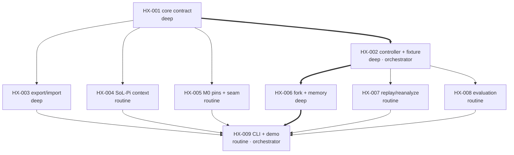

# Plan: M0 + M1 — portable offline slice of the scientific-agent harness

Implements the handoff in `docs/handoff/` (v0.2; `SOL_PI_DELTA.md` overrides
conflicting text, so the first agent adapter is Pi, not Prime). The critical
path is contract → controller/fixture → fork → CLI + end-to-end demo. The
shared contract (`labrun.canonical`, `labrun.records`, `labrun.store`) is
HX-001 and already landed; everything else builds on its public surface.

Test commands for every lane: `uv run pytest`, `uv run ruff check .`,
`uv run ruff format --check .`.

## HX-001 — Core contract

RFC 8785 canonical hashing (floats rejected), versioned frozen records with a
migration registry, a content-addressed store with commit-before-visible
ordering, hash-chained per-run journals, crash recovery, disposable index.

```yaml
id: HX-001
depth: deep
depends_on: []
footprint:
  modifies:  # landed in commit 8b63d2e
    - "pyproject.toml::*"
    - "src/labrun/__init__.py::*"
    - "src/labrun/canonical.py::*"
    - "src/labrun/errors.py::*"
    - "src/labrun/records.py::*"
    - "src/labrun/clock.py::*"
    - "src/labrun/store.py::*"
    - "tests/test_core.py::*"
produces:
  - "src/labrun/canonical.py::canonical_bytes"
  - "src/labrun/canonical.py::digest_of"
  - "src/labrun/canonical.py::sha256_digest"
  - "src/labrun/errors.py::LabrunError"
  - "src/labrun/records.py::Record"
  - "src/labrun/records.py::Checkpoint"
  - "src/labrun/records.py::InvocationReceipt"
  - "src/labrun/records.py::Run"
  - "src/labrun/store.py::Store"
  - "src/labrun/store.py::record_ref"
  - "src/labrun/clock.py::LogicalClock"
gate: "uv run pytest tests/test_core.py passes; ruff clean"
```

## HX-002 — Jobs gateway, budgets ledger, controller and synthetic fixture

The executable heart: a mock job gateway with durable submission intents and
reconciliation (T10), a budget ledger with experiment-level quotas,
reservations and three cost views (T11), a decision-provider interface with
mock and recorded implementations that fails closed on request change (T04,
T06), and a phase-driven controller that runs the synthetic fixture workflow
through all five checkpoint boundaries and resumes from the journal (T14).
Run by the orchestrator in the main working copy because every later lane
consumes its surface.

```yaml
id: HX-002
depth: deep
executor: orchestrator
depends_on: ["HX-001"]
footprint:
  creates:
    - "src/labrun/jobs.py"
    - "src/labrun/budgets.py"
    - "src/labrun/decisions.py"
    - "src/labrun/fixture.py"
    - "src/labrun/controller.py"
    - "tests/conftest.py"
    - "tests/test_jobs.py"
    - "tests/test_budgets.py"
    - "tests/test_decisions.py"
    - "tests/test_controller.py"
produces:
  - "src/labrun/controller.py::Controller"
  - "src/labrun/controller.py::RunState"
  - "src/labrun/fixture.py::PARSERS"
  - "src/labrun/fixture.py::POLICIES"
  - "src/labrun/budgets.py::cost_views"
  - "src/labrun/decisions.py::RecordedDecisionProvider"
  - "tests/conftest.py::fixture_run"
gate: "uv run pytest tests/test_jobs.py tests/test_budgets.py tests/test_decisions.py tests/test_controller.py passes (T04, T06, T10, T11 ledger, T14)"
assumptions:
  - "fork creation lives in HX-006; the controller only needs to resume a run whose first checkpoint was written by someone else"
```

## HX-003 — Export, import, profiles, capabilities

Bundle export (directory or deterministic tar.gz) with inventory manifest,
schemas, environment and provenance sections, ancestor closure, and
visibility profiles (agent-visible never contains evaluator data or
credentials). Import validates checksums, schema versions, closure, path
safety, link escapes, sizes and expansion, and never executes anything.
`inspect_capabilities` reports supported / blocked-by-missing-input /
blocked-by-environment / unavailable-provider-state. Thin bundles and
redaction produce explicit omissions. Tests build synthetic runs by hand
through `Store`, so this lane does not wait for the controller.

```yaml
id: HX-003
depth: deep
depends_on: ["HX-001"]
footprint:
  creates:
    - "src/labrun/portability.py"
    - "tests/test_portability.py"
produces:
  - "src/labrun/portability.py::export_bundle"
  - "src/labrun/portability.py::import_bundle"
  - "src/labrun/portability.py::inspect_capabilities"
gate: "uv run pytest tests/test_portability.py passes (T08, T12, T13 export side, T09 path independence)"
```

## HX-004 — SoL-Pi context mechanisms as recorded fixtures

ObservationPack handles backed by store digests (resolve after export/import),
paged recall as a recorded read, compaction events with trigger inputs,
evidence-preserving reducer receipts with deterministic verification and
recorded fallback, and Action Fusion decomposition that refuses to fuse
submit/cancel/budget-affecting operations. Offline, no Pi install.

```yaml
id: HX-004
depth: routine
depends_on: ["HX-001"]
footprint:
  creates:
    - "src/labrun/context.py"
    - "tests/test_context.py"
produces:
  - "src/labrun/context.py::ObservationPack"
gate: "uv run pytest tests/test_context.py passes (SOL_PI_DELTA M1 fixture tests)"
```

## HX-005 — M0 contracts: source pins, assumptions register, adapter seam

Pin upstream sources (Pi 0.85.1 npm integrity, SoL-Pi commit, RFC 8785
library, paper ids) in a machine-readable file; write the assumptions
register (handoff + SoL-Pi additions); sketch the smallest Pi adapter seam
as a typed Protocol plus a doc, without installing Pi.

```yaml
id: HX-005
depth: routine
depends_on: ["HX-001"]
footprint:
  creates:
    - "provenance/sources.json"
    - "docs/ASSUMPTIONS.md"
    - "docs/ADAPTER_SEAM.md"
    - "src/labrun/adapters/__init__.py"
    - "src/labrun/adapters/agents.py"
    - "tests/test_sources.py"
produces:
  - "src/labrun/adapters/agents.py::AgentAdapter"
gate: "uv run pytest tests/test_sources.py passes (sources.json parses, every pin has a revision or an explicit unresolved marker)"
```

HX-005 depends on HX-001 only for the package layout (ordering-only edge); HX-009
consumes its `AgentAdapter` seam when documenting the capability matrix.

## HX-006 — Fork, invalidation, visibility cut, provenance-filtered memory

Fork from a quiescent checkpoint with a validated declaration; compute the
invalidated set (changed node + descendants) for policy, parser, input and
wavefunction-like interventions; child view that refuses artifacts, records
and memory lessons outside its ancestry cut, including disguised summaries
derived from future evidence. Resumes via the HX-002 controller.

```yaml
id: HX-006
depth: deep
depends_on: ["HX-002"]
footprint:
  creates:
    - "src/labrun/forks.py"
    - "src/labrun/memory.py"
    - "tests/test_forks.py"
produces:
  - "src/labrun/forks.py::fork_run"
gate: "uv run pytest tests/test_forks.py passes (T03, T05, T07, T11 branch views)"
```

## HX-007 — Offline replay and deterministic reanalysis

Replay reconstructs events and checkpoint state with no network or provider
access and returns the normalized final state; reanalysis reruns a named pure
transform on recorded bytes, writes a new derivation receipt linked to the
original, and compares digests.

```yaml
id: HX-007
depth: routine
depends_on: ["HX-002"]
footprint:
  creates:
    - "src/labrun/replay.py"
    - "tests/test_replay.py"
produces:
  - "src/labrun/replay.py::replay_run"
  - "src/labrun/replay.py::reanalyze"
gate: "uv run pytest tests/test_replay.py passes (T02, replay half of T01)"
```

## HX-008 — Protected evaluation derivations

Fixture graders run over immutable outputs with references held only in an
evaluator store; each evaluation is a new record; comparison refuses mixed
evaluator versions.

```yaml
id: HX-008
depth: routine
depends_on: ["HX-002"]
footprint:
  creates:
    - "src/labrun/evaluation.py"
    - "tests/test_evaluation.py"
produces:
  - "src/labrun/evaluation.py::evaluate_run"
gate: "uv run pytest tests/test_evaluation.py passes (T16, T13 evaluator side)"
```

## HX-009 — CLI, clean-workspace demo, docs

`labrun` CLI matching PORTABLE_RUN_SPEC §14, the end-to-end sequence in a
fresh temp directory with network disabled (T01, T09), README with capability
matrix and limitations, repo agent instructions.

```yaml
id: HX-009
depth: routine
executor: orchestrator
depends_on: ["HX-003", "HX-004", "HX-005", "HX-006", "HX-007", "HX-008"]
footprint:
  creates:
    - "src/labrun/cli.py"
    - "tests/test_end_to_end.py"
    - "scripts/demo.sh"
    - "CLAUDE.md"
  modifies:
    - "README.md::*"
gate: "uv run pytest passes in full; scripts/demo.sh exits 0 in a fresh temp dir with network blocked"
```

## Graph



## Deviations

- HX-002 and HX-009 run in the orchestrator's main working copy rather than a
  lane: HX-002's surface is consumed by three later lanes and HX-009 is the
  integration sink.
