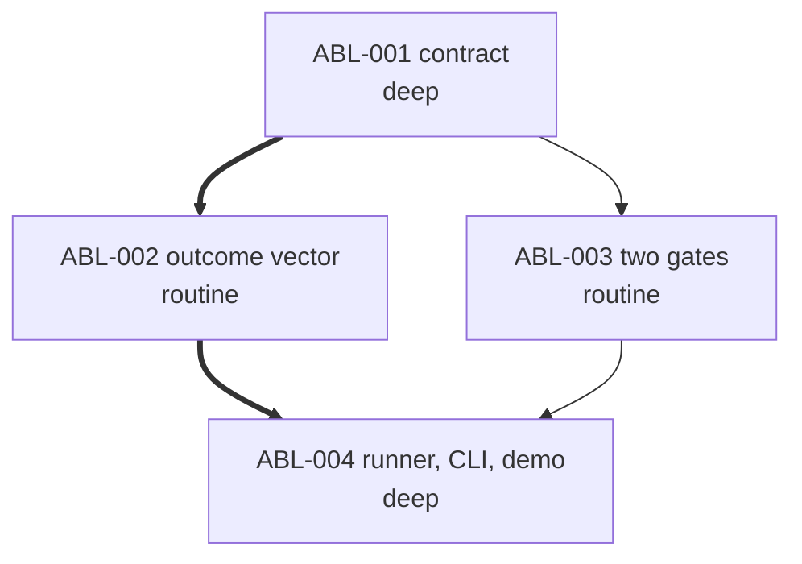

# Plan: M3b — SoL-Pi add-one ablation on Pi

SOL_PI_DELTA §3/§5: run the baseline arm (S1), each SoL-Pi mechanism alone
(S2a-d), and the full stack (S3) on the same cases, tools, information, and
evaluator; record each run's outcome vector (capability from the claim
evaluation, efficiency from the ingested run, per-mechanism activation, the
A15 reducer-loss probe); compare every arm to the baseline under SoL-Pi's two
gates with predeclared tolerances; and report S3 beside the sum of the S2a-d
deltas. No model credentials are authorized (A11), so ablations run the real
pinned Pi offline under the scripted provider and the report is labelled
synthetic, a harness exercise, not a mechanism verdict (A40).

How an ablation flows: `onoda ablation run spec.yaml` validates the spec and
tolerances, refuses cases outside the allowed splits (A42), runs every arm on
every case through `onoda.adapters.pi.run.run_case`, grades each claim with
`evaluate_claims` into the evaluator store, builds an `OutcomeVector` per run
(`ablation.metrics`), compares arms (`ablation.gates`), and writes one report
object to the evaluator store (it cites evaluations, so it never enters the
agent store).

The M3 plan is kept at `docs/plans/M3-PLAN.md`.

Critical path: contract → runner. Metrics and gates run beside each other
against the contract.

Test commands for every lane: `uv run pytest`, `uv run ruff check .`,
`uv run ruff format --check .`. The pinned Pi runtime is installed in the main
checkout (`scripts/pi-setup.sh`); a lane worktree that launches Pi runs it once.

## ABL-001 — Contract: arms, spec, outcome vector, tolerances, gate result

Landed in the main working copy before any lane: metric names and directions,
the spec and tolerance models, the outcome vector, the comparison result, and
assumptions A39-A42 (plus A15/A16 status notes).

```yaml
id: ABL-001
depth: deep
depends_on: []
footprint:
  modifies:  # landed in the main working copy before any lane dispatched
    - "docs/ASSUMPTIONS.md::*"
    - "PLAN.md::*"
    - "docs/plans/M3-PLAN.md::*"
    - "src/onoda/ablation/__init__.py::*"
    - "src/onoda/ablation/contract.py::*"
produces:
  - "src/onoda/ablation/contract.py::AblationSpec"
  - "src/onoda/ablation/contract.py::AblationCase"
  - "src/onoda/ablation/contract.py::OutcomeVector"
  - "src/onoda/ablation/contract.py::Tolerances"
  - "src/onoda/ablation/contract.py::MetricCheck"
  - "src/onoda/ablation/contract.py::ArmComparison"
  - "src/onoda/ablation/contract.py::CAPABILITY_METRICS"
  - "src/onoda/ablation/contract.py::EFFICIENCY_METRICS"
  - "src/onoda/ablation/contract.py::ACTIVATION_METRICS"
  - "src/onoda/ablation/contract.py::REDUCER_PROBE_METRICS"
  - "src/onoda/ablation/contract.py::DEFAULT_ARMS"
  - "src/onoda/ablation/contract.py::SINGLE_ARMS"
  - "src/onoda/ablation/contract.py::FULL_ARM"
  - "src/onoda/ablation/contract.py::ALLOWED_SPLITS"
  - "src/onoda/ablation/contract.py::REPORT_SCHEMA"
gate: "uv run python -c 'from onoda.ablation.contract import AblationSpec, Tolerances; Tolerances(justification=\"t\")' exits 0; uv run pytest and ruff clean"
```

## ABL-002 — Outcome vector from an ingested, evaluated run

`outcome_vector(store, evaluation, *, arm)` reads one ingested Pi run from the
agent store and its claim `Evaluation` (passed in; the evaluator store is never
opened from here) and returns an `OutcomeVector`: capability metrics copied
from the evaluation, efficiency metrics summed from the run's
`pi.provider-request` invocations (payload byte lengths by role, request
counts, response tokens and cost, left `None` when no response reported one)
and its acquisitions, activation counts from the run's own events, the
mechanism config digest from the run config, and the A15 probe: for each
`context.reduced` event, run the deterministic ORCA parser over the raw result
text, collect its evidence line texts, and count those absent from the visible
text. Tests run the real Pi (`requires_pi`) under a scripted provider for S1,
S2a (a large output that gets archived), S2b (a reducer receipt), and S2d (a
fused call), and cover the probe on a hand-built reduced result where a
reducer dropped an energy line.

```yaml
id: ABL-002
depth: routine
depends_on: ["ABL-001"]
footprint:
  creates:
    - "src/onoda/ablation/metrics.py"
    - "tests/test_ablation_metrics.py"
produces:
  - "src/onoda/ablation/metrics.py::outcome_vector"
  - "src/onoda/ablation/metrics.py::reducer_probe"
gate: "uv run pytest tests/test_ablation_metrics.py passes with the Pi runtime installed (no skips); full suite and ruff clean"
assumptions:
  - "the run config carries the variant's sol-pi.json under onoda.adapters.pi.contract.CTX_MECHANISMS or equivalent; if only a digest is recorded, record that"
  - "the scripted provider ignores unused reducer_turns/summary_turns"
```

## ABL-003 — Two-gate comparison and the S3 interaction report

Pure functions over outcome vectors and `Tolerances`, all `Decimal`, no store:
`pool(vectors)` sums each metric over an arm's runs (`None` if any run left
it unreported), `compare_arm(baseline, candidate, tolerances, efficiency_gate)`
returns an `ArmComparison` per the contract's rule, `non_dominated(arms)`
keeps eligible arms no other eligible arm beats on every declared efficiency
metric, and `interaction(deltas)` puts S3's delta beside the sum of S2a-d
deltas and their difference for every metric (`None` where any side is
missing). Missing tolerance → `unresolved`; false-success increase → `fail`
with any tolerance file; ties are not improvements (A41).

```yaml
id: ABL-003
depth: routine
depends_on: ["ABL-001"]
footprint:
  creates:
    - "src/onoda/ablation/gates.py"
    - "tests/test_ablation_gates.py"
produces:
  - "src/onoda/ablation/gates.py::pool"
  - "src/onoda/ablation/gates.py::compare_arm"
  - "src/onoda/ablation/gates.py::non_dominated"
  - "src/onoda/ablation/gates.py::interaction"
gate: "uv run pytest tests/test_ablation_gates.py passes, covering pass/fail/unresolved on both gates, the fixed false-success tolerance, ties, missing runs, non-dominance, and the interaction term; full suite and ruff clean"
```

## ABL-004 — Runner, report, CLI, demo, docs

`run_ablation(spec_path, *, store, evaluator_store, work_dir)` loads the spec,
tolerances, ladder, and scripts; refuses unknown cases, disallowed splits
(A42), and an ablation id already reported, before any run; runs every arm on
every case (`run_id = <ablation_id>-<arm>-<case_id>`), evaluates each claim,
builds outcome vectors, compares every non-baseline arm, and writes one
`onoda.ablation-report/1` JSON object to the evaluator store (labels
`ablation-report`, plus `synthetic` when any run was scripted) with
`evidence: synthetic` and the A40 caveat, per-arm pooled metrics, activation
per arm and model as `k/n` runs, the reducer probe, comparisons,
non-dominated set, and the S3 interaction. CLI `onoda ablation run` and
`onoda ablation show`; a demo.sh section; README and CLAUDE.md lines. The e2e
test runs the default six arms on one case on the real Pi.

```yaml
id: ABL-004
depth: deep
depends_on: ["ABL-002", "ABL-003"]
footprint:
  modifies:
    - "src/onoda/cli.py::*"
    - "scripts/demo.sh::*"
    - "README.md::*"
    - "CLAUDE.md::*"
  creates:
    - "src/onoda/ablation/run.py"
    - "tests/test_ablation_run.py"
    - "tests/ablation_fixtures/*"
produces:
  - "src/onoda/ablation/run.py::run_ablation"
gate: "uv run pytest tests/test_ablation_run.py passes with the Pi runtime installed (no skips); scripts/demo.sh exits 0; full suite and ruff clean"
```

## Graph



## Deviations
