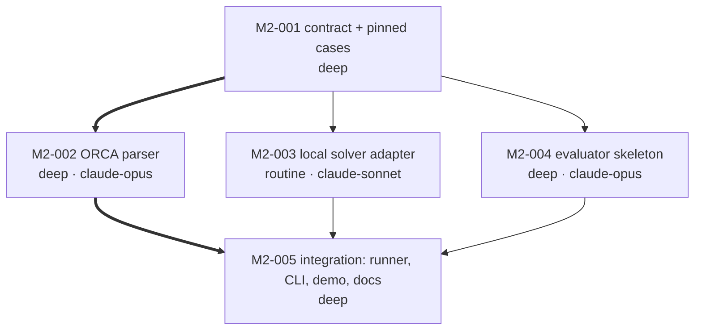

# Plan: M2 — scientific smoke tests (ORCA)

BUILD_SPEC §6 M2: local solver adapter, parsers, fixed-input reviewed cases,
external evaluator skeleton; gate "real artifacts validate; discrepancies and
unresolved checks are visible". ORCA is licensed and not installed here
(assumptions register A7), so authentic outputs come from cclib's public
regression data (BSD-3-Clause, pinned by commit and sha256) and live execution
is built but fails closed until an operator configures a user-provided binary.

The M0+M1 plan is kept at `docs/plans/M0-M1-PLAN.md`.

Critical path: contract → parser → integration (runner, CLI, demo, docs).
The solver adapter and evaluator run beside the parser.

Test commands for every lane: `uv run pytest`, `uv run ruff check .`,
`uv run ruff format --check .`.

## M2-001 — Contract: observation schema and pinned cases

The parsed-observation schema (`OrcaObservation`, `Quantity`, `Evidence`,
`Problem`) is the only thing parser and evaluator share. Case manifests pin
authentic ORCA inputs/outputs by sha256 with provenance, license, and review
status. Lands first, in the main working copy.

```yaml
id: M2-001
depth: deep
depends_on: []
footprint:
  modifies:  # landed in the main working copy before any lane dispatched
    - "src/labrun/science/__init__.py::*"
    - "src/labrun/science/contract.py::*"
    - "cases/orca/cclib/*"
    - ".gitattributes::*"
    - "PLAN.md::*"
produces:
  - "src/labrun/science/contract.py::OrcaObservation"
  - "src/labrun/science/contract.py::ExcitedState"
  - "src/labrun/science/contract.py::Quantity"
  - "src/labrun/science/contract.py::Evidence"
  - "src/labrun/science/contract.py::Problem"
  - "src/labrun/science/contract.py::CaseManifest"
  - "src/labrun/science/contract.py::load_case"
  - "src/labrun/science/contract.py::case_manifests"
gate: "uv run python -c 'from labrun.science.contract import case_manifests, load_case; [load_case(p) for p in case_manifests().values()]' exits 0"
```

## M2-002 — Deterministic ORCA output parser

`parse_orca_output(data, *, synthetic=False) -> OrcaObservation` for ORCA 5.x
and 6.x text output: program version, termination, SCF convergence and cycle
count, final single-point energy, excited states (TD-DFT/TDA state lines;
EOM/ADC `IROOT` lines), warnings. Every value is the printed decimal text
with units and line evidence. Partial, malformed, wrong-unit, and ambiguous
input yields explicit `Problem`s, never a default (T18). Values are
cross-checked against cclib's independent parse of the same authentic files.

```yaml
id: M2-002
depth: deep
executor: claude-opus
depends_on: ["M2-001"]
footprint:
  creates:
    - "src/labrun/science/orca_parser.py"
    - "tests/test_orca_parser.py"
  modifies:
    - "pyproject.toml::*"
    - "uv.lock::*"
produces:
  - "src/labrun/science/orca_parser.py::parse_orca_output"
  - "src/labrun/science/orca_parser.py::PARSER_ID"
gate: "uv run pytest tests/test_orca_parser.py passes, covering every vendored case plus truncated/missing-diagnostic/malformed-number/wrong-unit/ambiguous mutations"
assumptions:
  - "cclib is acceptable as a dev-only dependency for the cross-check; it must not become a runtime dependency"
  - "STEOM output may interleave CIS and STEOM root listings; if the parser can tell them apart by section it reports them, otherwise it reports ambiguous"
```

## M2-003 — Local ORCA solver adapter (fails closed)

A scheduler with the same surface as `labrun.jobs.MockScheduler`
(`submit/lookup/status/collect/cancel/executions`) that runs a
user-provided ORCA binary in a job directory outside the store. Disabled by
default; unresolved settings (binary path, wall-time limit, working root)
raise before anything runs. Submission intent is persisted before launch so
a repeated key never runs twice. Records the binary's sha256 and the exact
command. Tests use a clearly labelled stand-in executable, never presented
as ORCA.

```yaml
id: M2-003
depth: routine
executor: claude-sonnet
depends_on: ["M2-001"]
footprint:
  creates:
    - "src/labrun/science/orca_local.py"
    - "tests/test_orca_local.py"
produces:
  - "src/labrun/science/orca_local.py::OrcaSettings"
  - "src/labrun/science/orca_local.py::OrcaLocalScheduler"
gate: "uv run pytest tests/test_orca_local.py passes: disabled-by-default refusal, unresolved-setting refusal, idempotent resubmission, timeout -> failed status, stand-in outputs collected and labelled"
```

Ordering-only on M2-001: it needs the `labrun.science` package to exist.

## M2-004 — External evaluator skeleton

A protected derivation over `OrcaObservation`s: execution status, parse
integrity, state identification against the case's declared request, and
reference comparison under a declared policy. A policy with no justified
tolerance (assumptions A6) reports the numerical differences and marks the
check `unresolved`. Pairing states is by declared identity (multiplicity +
root order within multiplicity, symmetry must agree when both sides state
it), never by nearest energy. Writes new `Evaluation` records only to an
evaluator-visibility store.

```yaml
id: M2-004
depth: deep
executor: claude-opus
depends_on: ["M2-001"]
footprint:
  creates:
    - "src/labrun/science/evaluator.py"
    - "tests/test_science_evaluator.py"
produces:
  - "src/labrun/science/evaluator.py::ComparisonPolicy"
  - "src/labrun/science/evaluator.py::POLICIES"
  - "src/labrun/science/evaluator.py::publish_case_reference"
  - "src/labrun/science/evaluator.py::evaluate_observation"
gate: "uv run pytest tests/test_science_evaluator.py passes: unresolved-tolerance reports differences, missing evidence is unresolved not pass, symmetry disagreement is flagged, reference never written to an agent store, re-evaluation creates a new record"
```

## M2-005 — Integration: case runs, CLI, demo, docs

Record a fixed-input case as a run in the agent store (acquired authentic
outputs, or a live execution through M2-003 when enabled), parse it through
M2-002 as a derivation, and evaluate through M2-004 in a separate evaluator
store. `labrun case list|ingest|evaluate`, a demo section, the assumptions
rows this milestone adds, and the README capability matrix.

```yaml
id: M2-005
depth: deep
depends_on: ["M2-002", "M2-003", "M2-004"]
footprint:
  creates:
    - "src/labrun/science/runner.py"
    - "tests/test_smoke_cases.py"
  modifies:
    - "src/labrun/cli.py::*"
    - "scripts/demo.sh::*"
    - "docs/ASSUMPTIONS.md::*"
    - "README.md::*"
    - "CLAUDE.md::*"
gate: "full uv run pytest + ruff check + ruff format --check pass, and scripts/demo.sh prints the ORCA 6 vs 5 TD-DFT discrepancy as unresolved"
```

## Graph



## Deviations

- **M2-005 footprint widened after review.** The correctness review found
  that M1 commands crashed on or mislabelled case runs. Fixes touched
  `src/labrun/controller.py::Controller.resume` (refuses checkpoints that do
  not declare semantic restart) and `src/labrun/portability.py::_capabilities`
  (honours checkpoint-declared `semantic_restart`/`fork`/`reanalyze`), both
  outside the planned footprint. No lane was live, so nothing collided.
- **Lane files edited during integration.** `orca_parser.py` (undecodable
  bytes, unit-slot garbage, discarded-listing corruption), `orca_local.py`
  (launch errors, process-group timeout) and `evaluator.py` (receipt status,
  pinned manifest digest, empty policy) were changed by M2-005 after their
  lanes landed, each with tests.
- **Deferred structural findings** (for a later pass): share
  commit-before-visible primitives between `Controller` and the case runner;
  a public `Store.final_checkpoint`; a public evaluation-id helper instead of
  importing `labrun.evaluation._next_evaluation_id`.
